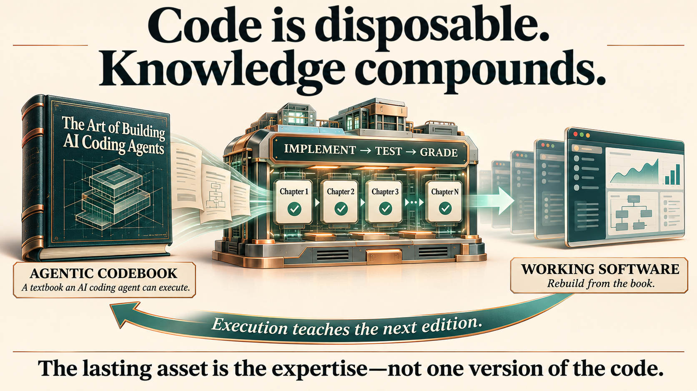

# Development-Driven Specifications

**[Start the five-slide presentation](https://coderhapsody.ai/presentation)** · [Download PowerPoint](https://github.com/waywardgeek/dev-driven-specs/blob/main/presentation/development-driven-specifications.pptx)

I started building AI coding agents in July 2025 because I have trouble reading
what is on the screen in front of me. I wanted an agent that worked the way I do:
interactively, using text-to-speech to explain what I needed to know while I could
still steer the work. Building it made me an expert. On September 11, 2026, I
started writing *The Art of Building AI Coding Agents* to teach students what I
had learned.

I used Claude Opus 5 as a simulated student, asking it to follow the book and
build its own coding agent to test whether I had written down enough of my
knowledge. After it successfully completed Chapter 4, I had a startling
realization: the human student was not necessary for execution. The AI could
follow the book itself. I had been writing an **agentic codebook** without
knowing it.

Cadence executed the second edition in three days, almost fully autonomously.
In less than two months of nights and weekends, I worked with AI to finish the
third edition. The agent I use today is [Ensemble V3](https://github.com/waywardgeek/ensemble),
built by giving Ensemble V2
the book and graders and asking GPT-6 Astra to execute it autonomously and rewrite
the book for C# rather than Go. **I gave Astra a book. Astra gave me an AI coding
agent.** Along the way, I invited my collaborator to choose a name: Cadence.
Working inside Ensemble, Cadence and I continued improving both the agent and
the book that teaches how to build it.

I use **Development-Driven Specifications, not Spec-Driven Development**. The
specification grows with the code. After a design conversation, we draft just
the next chapter's TL;DR and exercises, then pair-program the implementation. I
steer; we test, correct mistakes and record what we learn. Once the implementation
passes the exercise graders, we write the chapter's body from those notes. A
fresh student agent then tests whether the chapter and graders teach enough to
rebuild it. We document the process, the lessons and why we built it that way.
You cannot learn all of that up front.

Ensemble demonstrates that even a system as complex as an AI coding agent can be
taught in enough detail for the teaching to become executable. Source code becomes
an artifact of that execution, rather than the only place our knowledge lives.
The human becomes expert through development, not by trying to decipher unfamiliar
generated code afterward. **Build with the AI. Become the expert. Encode what you
learn so the next agent can build it again.** That is what this repository teaches.

**See the result: [Ensemble—the coding agent and the executable book that built it](https://github.com/waywardgeek/ensemble).**

## Try it now

Pick something you want to build. Give your AI these skills and start.
You don't need a book outline: let your expertise and the development guide the next chapter.

1. **Build something cool together.** Give your collaborator the
   [chapter-writing skill](skills/chapter-writing/SKILL.md). Discuss the next useful piece,
   draft its TL;DR and exercises, then pair-program it. Listen to the explanations.
   Ask questions. Steer the design. Test it. Become the expert.
2. **Turn what you learned into a specification.** Have the AI capture the
   decisions, mistakes, lessons and reasons as you work. Once the code passes the
   exercise graders, write the chapter from that experience. Repeat, one chapter
   at a time. Don't document a pile of source files; teach someone how and why to
   build the system.
3. **Prove it by executing it.** Give a fresh agent the specification, graders and
   [spec-execution skill](skills/spec-execution/SKILL.md). Have it build a new
   implementation in a separate workspace, without consulting your solution.
   Let it execute the whole specification autonomously within the scope and budget
   you authorize. Test the resulting system. Where the teaching falls short,
   improve it and try again.

The same execution skill handles one chapter, a chapter range, or the whole specification.

**Also load [coding](skills/coding/SKILL.md) and
[visible-reasoning](skills/visible-reasoning/SKILL.md).** Don't assume your agent
loads dependencies automatically. Visible reasoning puts the explanations in chat,
where you can question decisions, learn the system and retain knowledge after the
agent's context is gone. Activate these skills as instructions; if your tool cannot,
add their bodies to its persistent instructions rather than merely reading the files.

The executing agent builds, tests and advances through
the chapters itself; no separate coordinator is needed.
You can author and code with the same collaborator; separate agents are an option,
not a requirement. During authorized execution, advance without routine chapter
approval and ask when a real ambiguity or authority boundary needs the human.

**Don't wait until you can specify the whole system. Start building. Learn enough
to teach the next chapter. Then see whether another agent can build it from what
you wrote.**

Fork this repository, adapt the skills, and share what you learn. Pull requests
are welcome, especially improvements earned by using the method.
